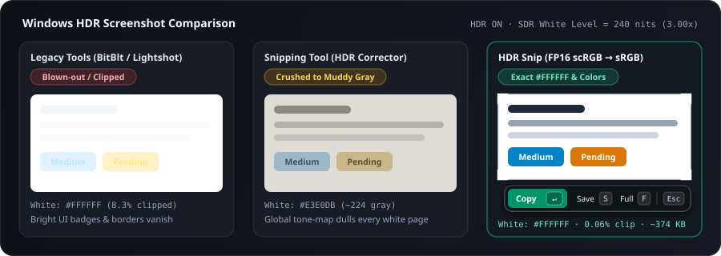

# HDR Snip

**A tiny (~374 KB), zero-dependency native Rust screenshot tool for Windows HDR displays — true `#FFFFFF` whites, accurate sRGB colors, and a crisp Keycap Minimal crop overlay.**

[](https://github.com/Junior774/hdr-snip/releases)
[](https://www.rust-lang.org/)
[](https://github.com/Junior774/hdr-snip/releases/latest)
[](LICENSE)

<p align="center">
  
</p>

---

## Why I Built This

If you use Windows with **HDR turned on**, taking a simple screenshot is weirdly broken:

1. **Classic screenshot tools** (Lightshot, legacy `BitBlt` / 8-bit capture) capture raw HDR luminance into 8-bit sRGB, causing **blown-out whites, glowing halos, and unreadable pastel UI badges**.
2. **Windows Snipping Tool's "HDR screenshot color corrector"** fixes the overexposure by running a global HDR tone-mapper — which crushes pure `#FFFFFF` white pages (Docs, Notion, IDEs, dashboards) down into a **muddy gray-beige (`~#E3E0DB` / RGB `224`)**.

I didn't want to disable HDR just to take clean screenshots, nor install a bloated runtime. So I built **HDR Snip** as a standalone native Rust binary (~374 KB, ~4 MB idle RAM, 0% CPU) that intercepts `PrintScreen` and `Win + Shift + S` and solves the problem mathematically at the DWM/WinRT level.

---

## How It Works

When you hit `PrintScreen` or `Win + Shift + S`:

1. **Detects the monitor under your cursor** and queries its live HDR state and **exact SDR White Level** (`DISPLAYCONFIG_DEVICE_INFO_GET_SDR_WHITE_LEVEL` via `QueryDisplayConfig`, e.g., `240 nits = 3.00×`).
2. **Captures in 16-bit linear float (`R16G16B16A16Float` scRGB)** via WinRT `Windows.Graphics.Capture` when HDR is enabled (or fast `BGRA8` when on an SDR monitor).
3. **Recovers exact SDR luminance** by dividing linear scRGB channels by your display's exact SDR white multiplier and encoding exact sRGB through a precomputed **16K lookup table** (`~50 ms` full 1080p capture).
4. **Opens a zero-flicker, pure-Rust anti-aliased overlay** (*Keycap Minimal* UI) with Per-Monitor DPI awareness so it stays sharp at any resolution or scaling (`100%`–`200%`).
5. **Copies to the clipboard in both `CF_DIB` and `PNG` formats** so pasting works seamlessly in browsers, Discord, Slack, WhatsApp, Word, Paint, and IDEs.

---

## Features

- **Pixel-exact HDR → sRGB conversion** — pure white stays `#FFFFFF` (`255`), not `224` gray and not blown-out clipped highlights.
- **Drop-in hotkeys** — seamlessly intercepts `PrintScreen` and `Win + Shift + S` (without popping up the Start Menu or triggering Snipping Tool).
- **Keycap Minimal UI** — pure-Rust analytical SDF anti-aliased rounded capsules, soft drop shadows, double-contrast borders (legible on both pure white and pure black screens), corner L-brackets, and vector icons.
- **Multi-resolution & Per-Monitor DPI aware** — works across `1080p`, `1440p`, `4K`, ultrawide, and mixed HDR/SDR multi-monitor setups.
- **Tiny & self-contained** — single ~374 KB `.exe`, zero external DLLs or runtimes, ~4 MB RAM in the system tray, 0% idle CPU.
- **All-users Windows installer** — one script installs into `C:\ProgramData\hdr-snip\` with shared Startup so every Windows account on the PC gets it automatically.

---

## Installation

### Option A — Quick Install (No Rust Required)

1. Download **`hdr-snip.exe`** and **`install_all_users.ps1`** from the [**Latest Release**](https://github.com/Junior774/hdr-snip/releases/latest) into the same folder.
2. **Portable mode:** just double-click `hdr-snip.exe` to run it in your system tray right away.
3. **Install for all Windows users (auto-start on login):** run in PowerShell:
   ```powershell
   powershell -ExecutionPolicy Bypass -File .\install_all_users.ps1
   ```
   *(If you previously used Lightshot or another tool bound to `PrintScreen`, close or disable it at startup so it doesn't compete for the hotkey.)*

To uninstall from all users at any time:
```powershell
powershell -ExecutionPolicy Bypass -File .\uninstall_all_users.ps1
```

### Option B — Build from Source

Requires Rust (`stable-x86_64-pc-windows-msvc`) and the Windows 10/11 SDK:

```powershell
git clone https://github.com/Junior774/hdr-snip.git
cd hdr-snip
cargo build --release
```

The standalone binary is produced at `target\release\hdr-snip.exe`. Run `.\install_all_users.ps1` to install it system-wide.

---

## Usage & Shortcuts

| Action | Shortcut |
| :--- | :--- |
| Freeze screen & open crop overlay | `PrintScreen` or `Win + Shift + S` |
| Copy selection to clipboard (`CF_DIB` + `PNG`) | `Enter` · `C` · `Ctrl+C` · Double-click inside crop |
| Save selection as PNG (also copies to clipboard) | `S` · `Ctrl+S` |
| Select entire monitor | `F` |
| Cancel & close overlay | `Esc` · Right-click |
| Adjust selection | Drag inside to move · Drag any corner or edge to resize |

**System Tray Icon:**
- **Left-click** — capture immediately.
- **Right-click** — shows live HDR status (`HDR ON · 240 nits (3.00× → sRGB)` or `SDR`), pause/resume hotkeys, or exit.

---

## OS Compatibility

| Platform / Version | Status | Notes |
| :--- | :--- | :--- |
| **Windows 11 (21H2+)** | Full support | Native borderless FP16 WGC capture, Per-Monitor DPI, all features tested. |
| **Windows 10 (1903 – 22H2)** | Supported (minor caveat) | HDR FP16 capture works; Windows 10 briefly flashes the system WGC yellow capture border during the ~50 ms grab (`SetIsBorderRequired` was added in Win11). |
| **Older Windows / Linux / macOS** | Planned | Tracked in [Issues](https://github.com/Junior774/hdr-snip/issues) — contributions welcome! |

---

## Contributing

Issues, PRs, and ideas are very welcome! Check the [open issues](https://github.com/Junior774/hdr-snip/issues) if you'd like to help with:
- Borderless DXGI Desktop Duplication fallback for Windows 10 & older Windows versions
- Automatic OS language detection (English / i18n)
- Multi-monitor virtual desktop spanning & optional quick annotations

---

## License

Released under the [MIT License](LICENSE).
